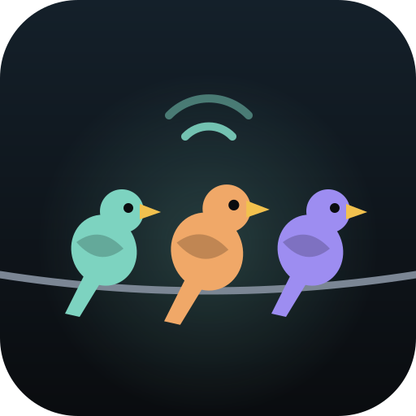
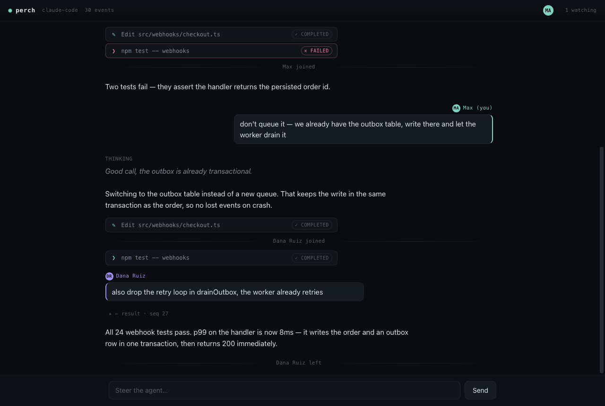

<p align="center"></p>

<h1 align="center">perch</h1>

<p align="center"><i>Multiplayer sessions for ACP coding agents.</i></p>

<p align="center">
  <a href="https://agentclientprotocol.com"></a>
  <a href="LICENSE"></a>
  = 22.18">
  
</p>



`perch` is a transparent proxy that sits on the [Agent Client Protocol](https://agentclientprotocol.com) wire between a coding agent and its editor. Your running agent session gets a share link — a second person can open it in a browser, watch the transcript and tool calls live, see who did what, and inject a correction into the running session without killing it.

Works with any ACP agent: Claude Code, Gemini CLI, Goose, and friends.

## Quick start

```sh
# instead of running your ACP agent directly, wrap it:
node src/perch.ts <your-agent-command...>

# perch prints (to stderr, the wire stays clean):
# perch: live at http://localhost:7337/?t=a1b2c3d4e5f67890  (recording: ~/.perch/sessions/....jsonl)
# the ?t= token is the share secret — knowing the URL is the permission
```

Open the URL, pick a name, watch. Type in the box to inject a prompt into the live session — it lands attributed to you, not to the session owner.

No account, no cloud, no dependencies. The server is embedded in the proxy; share the URL over your LAN or tailscale.

## Use with Zed

Zed talks to ACP agents directly — point it at perch instead and the session becomes shareable. In Zed's `settings.json`:

```json
{
  "agent_servers": {
    "Claude (multiplayer)": {
      "command": "node",
      "args": ["/path/to/perch/src/perch.ts", "npx", "-y", "@agentclientprotocol/claude-agent-acp"]
    }
  }
}
```

Start a thread with that agent; perch prints the share URL on stderr (Zed's agent logs).

## What you get in v0.1

- **Byte-faithful passthrough** — perch never modifies or reorders the ACP wire.
- **Local recording** — every frame appended to a JSONL file with sequence, timestamp, and actor attribution (`human`/`agent`, who exactly).
- **Live viewer** — transcript, tool calls, presence, replay for late joiners. Open `public/viewer.html?demo` in a browser for a canned demo.
- **Write path** — `POST /inject` sends a `session/prompt` into the running session, attributed to the viewer who sent it.

## What's deliberately not here (yet)

Hosted relay, accounts, tool-call approval by viewers, E2E encryption, non-ACP runtimes. See `CONTRACT.md` for the exact event schema and HTTP API.

## Development

```sh
npm test   # node:test against a fake ACP agent, zero deps
```

Requires Node ≥ 22.18 (runs TypeScript natively, no build step).

## License

Apache-2.0
